<div align="center">



<a href="https://git.io/typing-svg">
  
</a>

<br />

<a href="https://lorenzoairoldi-lab.github.io/Portfolio"></a>
<a href="https://www.linkedin.com/in/lorenzo-airoldi"></a>
<a href="mailto:lorenzo.airoldi17@gmail.com"></a>

</div>

## `> whoami`

<!-- macOS Terminal Window -->
<div align="center">
  <table border="0" cellspacing="0" cellpadding="0" style="width: 100%; max-width: 800px; border-radius: 10px; overflow: hidden; border: 1px solid #1E293B; background-color: #0A192F;">
    <!-- Terminal Header (Mac Window Controls) -->
    <tr style="background-color: #0F172A; height: 36px;">
      <td style="padding-left: 14px; vertical-align: middle; width: 80px;">
        <span style="height: 12px; width: 12px; background-color: #FF5F56; border-radius: 50%; display: inline-block; margin-right: 4px;"></span>
        <span style="height: 12px; width: 12px; background-color: #FFBD2E; border-radius: 50%; display: inline-block; margin-right: 4px;"></span>
        <span style="height: 12px; width: 12px; background-color: #27C93F; border-radius: 50%; display: inline-block;"></span>
      </td>
      <td style="text-align: center; color: #94A3B8; font-family: -apple-system, BlinkMacSystemFont, 'Segoe UI', Roboto, sans-serif; font-size: 13px; font-weight: 500; vertical-align: middle;">
        lorenzo-airoldi@cloud-engineer: ~ (zsh)
      </td>
      <td style="width: 80px;"></td>
    </tr>
    <!-- Terminal Content -->
    <tr>
      <td colspan="3" style="padding: 18px; font-family: 'Fira Code', 'Courier New', Courier, monospace; font-size: 14px; line-height: 1.6; color: #FFFFFF; text-align: left;">
        <span style="color: #00D2FF; font-weight: bold;">lorenzo@cloud-node</span>:<span style="color: #38BDF8;">~</span>$ ./profile --status<br/><br/>
        <span style="color: #00D2FF; font-weight: bold;">NAME</span>         Lorenzo Airoldi<br/>
        <span style="color: #00D2FF; font-weight: bold;">ROLE</span>         Junior Cloud Specialist @ Sunnyvale srl ☀️<br/>
        <span style="color: #00D2FF; font-weight: bold;">LOCATION</span>     Turin, Italy<br/>
        <span style="color: #00D2FF; font-weight: bold;">MISSION</span>      Build secure, repeatable and resilient infrastructure<br/>
      </td>
    </tr>
  </table>
</div>

<br/>

I turn cloud concepts into hands-on projects. My path combines **Microsoft Azure**, **DevOps**, infrastructure automation, Linux administration and networking—with a strong preference for learning by building.

- ☀️ Working as Junior Cloud Specialist at **Sunnyvale srl**
- ☁️ Studied Cloud Computing at **ITS ICT Piemonte**
- ⚙️ Exploring automation, CI/CD and **Infrastructure as Code**
- 🐧 Working across Linux systems, containers and networks
- 🔐 Designing with reliability and security in mind

## `> load_stack`

<div align="center">

### Cloud & DevOps


### Systems & Development


`Linux administration` · `Networking` · `REST APIs` · `Scripting` · `Automation`

</div>

## `> ls featured_projects/`

| Project | What lives inside | Signal |
| :--- | :--- | :---: |
| [**Portfolio**](https://github.com/lorenzoairoldi-lab/Portfolio) | Interactive Cloud Engineering portfolio built with vanilla HTML, CSS and JavaScript. | `LIVE` |
| [**Projects**](https://github.com/lorenzoairoldi-lab/Projects) | A curated collection of hands-on projects developed to sharpen technical skills. | `BUILDING` |
| [**Tool**](https://github.com/lorenzoairoldi-lab/Tool) | DevOps, Linux, Docker and system administration guides and quick references. | `OPEN` |

## `> cat certifications.log`

```text
[OK]        Agile Scrum Basic
[OK]        Linux Essentials
[OK]        CCNA: Introduction to Networks
[OK]        Claude 101
