 

## `> whoami`

  

 

I turn cloud concepts into hands-on projects. My path combines **Microsoft Azure**, **DevOps**, infrastructure automation, Linux administration and networking, with a strong preference for learning by building.

- ☀️ Cloud Specialist at **Sunnyvale srl**
- ☁️ Studied Cloud Computing at **ITS ICT Piemonte**
- ⚙️ Exploring automation, CI/CD and **Infrastructure as Code**
- 🐧 Working across Linux systems, containers and networks
- 🔐 Designing with reliability and security in mind

## `> load_stack`

### Cloud & DevOps

### Systems & Development

`Linux administration` · `Networking` · `REST APIs` · `Scripting` · `Automation`

## `> ls featured_projects/`

<table>
  <tr>
    <td align="center" width="33%">
      
       <code>LIVE</code> · Interactive Cloud Engineering portfolio
    </td>
    <td align="center" width="33%">
      
       <code>BUILDING</code> · Hands-on technical projects
    </td>
    <td align="center" width="33%">
      
       <code>OPEN</code> · DevOps, Linux & Docker quick references
    </td>
  </tr>
</table>

## `> cat certifications.log`

  

 

